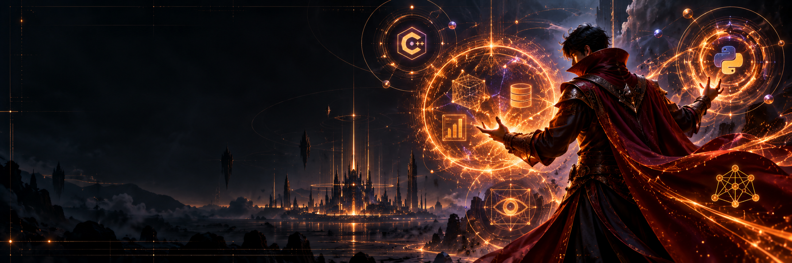
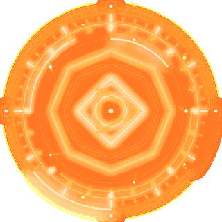
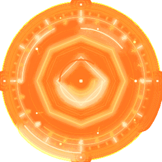

<h1>AMANPAL9 · THE ARCANE ENGINEER</h1>

<b>C++ · DATA · ALGORITHMS · COMPUTER VISION</b> Turning difficult problems into clear, useful systems.

  <a href="#-the-dossier">THE DOSSIER</a> &nbsp;✦&nbsp;
  <a href="#-active-spellwork">ACTIVE SPELLWORK</a> &nbsp;✦&nbsp;
  <a href="#-case-files">CASE FILES</a> &nbsp;✦&nbsp;
  <a href="#-arcane-toolkit">THE TOOLKIT</a> &nbsp;✦&nbsp;
  <a href="#-practice-ledger">PRACTICE LEDGER</a>

  
  &nbsp;&nbsp;&nbsp;
  

## ✦ The dossier

> **C++ developer, data explorer, and problem solver.** I work across algorithms, data analysis, visualization, and practical tooling—looking for the signal in a messy problem and engineering a clear path through it.
>
> **My method:** learn deliberately, build carefully, check edge cases, and keep the result useful.

## ◈ Active spellwork

| Portal status | Current focus |
| --- | --- |
| **Study** | C++, DSA, Python, SQL/MySQL, and structured problem solving |
| **Build** | Data analysis, visualizations, web scraping, and practical dashboards |
| **Explore** | Computer vision, basic machine learning, and insight-driven workflows |
| **Practice** | LeetCode · 100 solved &nbsp;&#124;&nbsp; Codeforces · rating 900 |

## 🌀 Case files

| Case file | Investigation |
| --- | --- |
| **01 · US Accident Data Analysis** | Exploratory analysis and visual storytelling to uncover accident patterns. |
| **02 · Titanic / Passenger Survival Analysis** | Data cleaning, exploration, and survival-focused analysis. |
| **03 · [GitHub Repository Scraper & Analysis](https://github.com/Amanpal9/github-webscraping-projeect)** | Web scraping and analysis of repository data. |
| **04 · [Real-Time Stock Analysis Dashboard](https://github.com/Amanpal9/Ai-us-stocks-analysis)** | Market-data exploration presented through a dashboard. |

<b>Field notes · How I approach a problem</b>

 

I like moving from raw data and vague requirements to decisions that are visible, reproducible, and useful—whether that means a clean C++ solution, an analytical notebook, or a small web tool.

## ⌘ Arcane toolkit

<b>Languages & foundations</b>

<b>Data, vision & analysis</b>

## 🧿 Practice ledger

&nbsp;

## ✧ Open the portal

Always open to learning, collaboration, and interesting problems.

Original portal-tech artwork with fan-inspired sorcerer styling; not affiliated with Marvel. The animated rings are original visuals created for this profile.

