<picture>
  <source media="(max-width: 600px) and (prefers-reduced-motion: reduce)" srcset="assets/account-panels/01-sanctum-mobile-still.svg">
  <source media="(max-width: 600px)" srcset="assets/account-panels/01-sanctum-mobile.svg">
  <source media="(prefers-reduced-motion: reduce)" srcset="assets/account-panels/01-sanctum-still.svg">
  
</picture>

<a href="#the-builder">The builder</a> · <a href="#the-spellbook">The spellbook</a> · <a href="#project-portals">Project portals</a> · <a href="#public-work">Public work</a> · <a href="#open-a-portal">Connect</a>

<picture>
  <source media="(max-width: 600px) and (prefers-reduced-motion: reduce)" srcset="assets/account-panels/02-builder-mobile-still.svg">
  <source media="(max-width: 600px)" srcset="assets/account-panels/02-builder-mobile.svg">
  <source media="(prefers-reduced-motion: reduce)" srcset="assets/account-panels/02-builder-still.svg">
  
</picture>

<picture>
  <source media="(max-width: 600px) and (prefers-reduced-motion: reduce)" srcset="assets/account-panels/03-spellbook-mobile-still.svg">
  <source media="(max-width: 600px)" srcset="assets/account-panels/03-spellbook-mobile.svg">
  <source media="(prefers-reduced-motion: reduce)" srcset="assets/account-panels/03-spellbook-still.svg">
  
</picture>

<picture>
  <source media="(max-width: 600px) and (prefers-reduced-motion: reduce)" srcset="assets/account-panels/04-portals-mobile-still.svg">
  <source media="(max-width: 600px)" srcset="assets/account-panels/04-portals-mobile.svg">
  <source media="(prefers-reduced-motion: reduce)" srcset="assets/account-panels/04-portals-still.svg">
  
</picture>

<a href="https://github.com/Amanpal9/github-webscraping-projeect">
<picture>
  <source media="(max-width: 600px) and (prefers-reduced-motion: reduce)" srcset="assets/account-panels/05-github-webscraping-projeect-mobile-still.svg">
  <source media="(max-width: 600px)" srcset="assets/account-panels/05-github-webscraping-projeect-mobile.svg">
  <source media="(prefers-reduced-motion: reduce)" srcset="assets/account-panels/05-github-webscraping-projeect-still.svg">
  
</picture>
</a>

<a href="https://github.com/Amanpal9/Ai-us-stocks-analysis">
<picture>
  <source media="(max-width: 600px) and (prefers-reduced-motion: reduce)" srcset="assets/account-panels/05-Ai-us-stocks-analysis-mobile-still.svg">
  <source media="(max-width: 600px)" srcset="assets/account-panels/05-Ai-us-stocks-analysis-mobile.svg">
  <source media="(prefers-reduced-motion: reduce)" srcset="assets/account-panels/05-Ai-us-stocks-analysis-still.svg">
  
</picture>
</a>

<a href="https://github.com/Amanpal9/Community-X">
<picture>
  <source media="(max-width: 600px) and (prefers-reduced-motion: reduce)" srcset="assets/account-panels/05-Community-X-mobile-still.svg">
  <source media="(max-width: 600px)" srcset="assets/account-panels/05-Community-X-mobile.svg">
  <source media="(prefers-reduced-motion: reduce)" srcset="assets/account-panels/05-Community-X-still.svg">
  
</picture>
</a>

<a href="https://github.com/Amanpal9?tab=repositories">
<picture>
  <source media="(max-width: 600px) and (prefers-reduced-motion: reduce)" srcset="assets/account-panels/06-public-work-mobile-still.svg">
  <source media="(max-width: 600px)" srcset="assets/account-panels/06-public-work-mobile.svg">
  <source media="(prefers-reduced-motion: reduce)" srcset="assets/account-panels/06-public-work-still.svg">
  
</picture>
</a>

<picture>
  <source media="(max-width: 600px) and (prefers-reduced-motion: reduce)" srcset="assets/account-panels/06-practice-mobile-still.svg">
  <source media="(max-width: 600px)" srcset="assets/account-panels/06-practice-mobile.svg">
  <source media="(prefers-reduced-motion: reduce)" srcset="assets/account-panels/06-practice-still.svg">
  
</picture>

<a href="https://github.com/Amanpal9">
<picture>
  <source media="(max-width: 600px) and (prefers-reduced-motion: reduce)" srcset="assets/account-panels/07-contact-mobile-still.svg">
  <source media="(max-width: 600px)" srcset="assets/account-panels/07-contact-mobile.svg">
  <source media="(prefers-reduced-motion: reduce)" srcset="assets/account-panels/07-contact-still.svg">
  
</picture>
</a>

Read the profile as text
<h2>Amanpal9 / The Developer Sanctum</h2>
I enjoy C++, algorithms, data exploration, and building practical tools.

Skills and interests carried forward from my existing profile: C++, DSA, Python, SQL/MySQL, Pandas, NumPy, Matplotlib, Seaborn, Tableau, web scraping, and Git/GitHub. Public project code also includes JavaScript, PHP, Node.js, Express, EJS, MongoDB, and Socket.IO.
<h3>Public projects</h3><ul><li><a href="https://github.com/Amanpal9/github-webscraping-projeect">GitHub Repository Scraper</a> — A Python notebook for collecting GitHub topic pages, parsing repository information, and exporting CSV files.</li><li><a href="https://github.com/Amanpal9/Ai-us-stocks-analysis">Expense Sharing Dashboard</a> — An expense-sharing interface with a PHP API and SQL schema. Repository name: Ai-us-stocks-analysis.</li><li><a href="https://github.com/Amanpal9/Community-X">Community-X</a> — A fork of HarshitPatel-01/Community-X for a student network. Node.js, Express, MongoDB, EJS, and Socket.IO.</li></ul>
Community-X is a fork of <a href="https://github.com/HarshitPatel-01/Community-X">HarshitPatel-01/Community-X</a>. Its inclusion describes a repository I explore; it does not claim original authorship of the upstream platform.

Doctor Strange inspired · User-supplied artwork · Independent personal profile · <a href="ASSET-CREDITS.md">Artwork and source notes</a>

